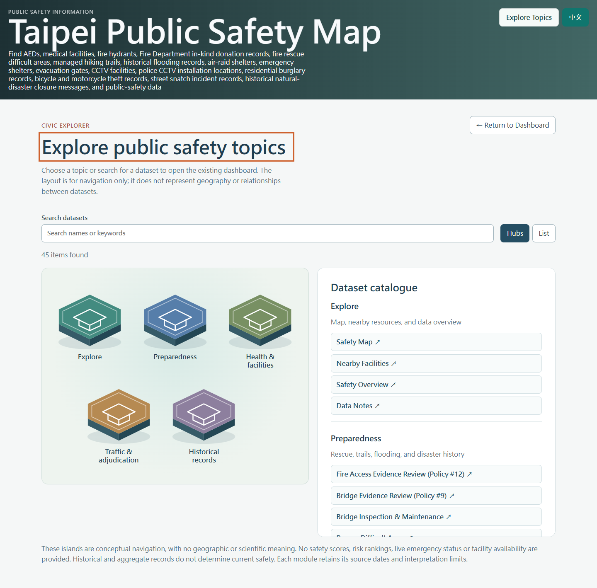
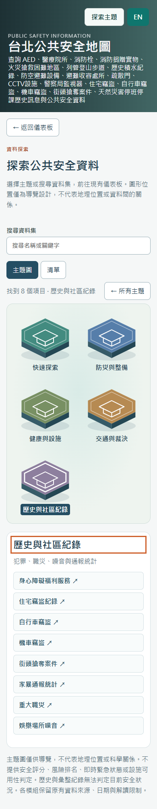

# Civic Explorer delivery — 2026-10-29

Optional catalogue navigation for the Public Safety Map, based on current main `4eb42b0`. The dashboard/map remains the default, including `?view=fire-rescue-access-policy` direct entry. Delivery is one feature branch, `codex/civic-explorer`, and one Draft PR for manual review and merge.

## Architecture and reuse

- `src/navigation.ts` relocates the existing `Tab` and `NavigationGroup` unions and five-group catalogue from App. Both navigators use this one catalogue. All 44 original mappings and localized labels are frozen in `src/test-fixtures/navigation-baseline.json`. The already-implemented smoking-cessation directory gains its missing catalogue entry, giving 45 destinations; no new analytical feature is introduced.
- `src/explorerModel.ts` derives both-language search keywords from catalogue labels and IDs only. It never imports or fetches source records. Literal search respects group selection, handles either language regardless of display language and treats case-insensitively.
- `src/CivicExplorer.tsx` accepts host groups and a destination callback. Layered decorative SVG tiles, HTML buttons, scene/list modes, responsive details, focus handling and reduced-motion styles adapt the established MIT patterns. No WebGL, animation library or dependency was added. Full attribution is in [civic-explorer-attribution.md](civic-explorer-attribution.md).
- `App.tsx` adds only optional view/focus orchestration around the original dashboard subtree. Opening Explorer hides that subtree with `hidden`; it does not change activeTab, data loading, panel mounting rules or filters. Destination selection validates the catalogue ID, updates the existing group and Tab states, closes Explorer and focuses the active module button. Return restores the entry button. The existing Leaflet ResizeObserver handles visibility changes.
- `ExplorerBoundary.tsx` preserves a usable dashboard-return button if the optional chunk fails. Loading also exposes a return action. Explorer and its CSS load only on entry; policy panels retain their original lazy and visited-state behavior.

The small host adaptation follows Portfolio v3.0.1 / Portfolio main `3201c41`, Real Estate main `99a7217`, and Feitsui implementation head `c16164c`. Feitsui PR #8 was **open Draft, not merged**, at inspection. No reference repository was modified. This is not a new shared package or Portfolio's complete generic URL API.

## Navigation and screenshots

The complete bilingual mapping is in [civic-explorer-navigation.md](civic-explorer-navigation.md): Explore 4, Preparedness 11, Health & Facilities 15, Traffic & Adjudication 7, Historical Records 8.

| Desktop | Mobile |
| --- | --- |
|  |  |

Additional [Chinese desktop](evidence/civic-explorer/zh-1440.png), [English mobile](evidence/civic-explorer/en-390.png), [English mobile list](evidence/civic-explorer/en-390-list.png) and [Chinese mobile list](evidence/civic-explorer/zh-390-list.png) screenshots are retained. External map/background images were deterministically stubbed for browser QA; screenshots show the rendered production UI, not a mockup.

## Accessibility and interaction evidence

[151 production browser checks](evidence/civic-explorer/browser-results.json) passed with zero unexpected page errors. Both English and Traditional Chinese were exercised at 320, 390, 768 and 1440 CSS pixels. Mobile contexts enable touch; actual `tap()` entry/return is checked.

- Five native button hubs and 45 module buttons; decorative SVG is hidden from assistive technology. All Explorer buttons measure at least 44 × 44 pixels, with visible focus outlines and no horizontal page overflow.
- Enter opens Explorer and focuses its heading; Space selects a group and focuses the detail heading; Tab reaches its modules; Escape clears group selection and restores the prior hub. Reset clears filters and restores search focus. Return focuses the persistent dashboard entry; destination selection focuses the existing active module button.
- Polite result counts, selected-group `aria-pressed`, labeled search and display modes, and full HTML list fallback. Reduced-motion checks verify both zero transition duration and no selected/hover lift; ordinary CSS hover is also tested.
- All 44 prior mappings actually select their existing host tab and render content; smoking cessation is separately checked. One actual destination per group is additionally exercised at all eight language/width combinations.
- A non-default map district and enabled AED layer survive both entry/return and navigation through other modules back to the map. Actual Leaflet element identity, map transform, checkbox values and filter values are retained. Nearby, burglary, bicycle, towing and both policy panels retain their mounted DOM, filtered content and state with no repeated data requests. Burglary uses non-default district, year, month and time-of-day filters together.
- Direct entry to Fire Rescue Access Policy remains optional at desktop/mobile widths; neither Explorer nor the other policy chunk is fetched by default. A deliberately aborted Explorer JS chunk leaves a working return to the existing dashboard.

The [visual verdict](evidence/civic-explorer/visual-verdict.json) passes at 95/100. An initial 87/100 verdict identified the mobile masthead being squeezed by the new actions; controls now occupy their own row on small screens. These are visual/DOM/keyboard checks, not a screen-reader certification.

## Safety, privacy and data integrity

[Protected-scope verification](evidence/civic-explorer/protected-scope.json) confirms **358 pre-existing protected files unchanged**, including public assets, official snapshots, ETL and validation scripts, loaders, types, policy modules, exports and privacy handling. App's entire SafetyMap and inline-module implementation tail is unchanged after newline normalization (SHA-256 recorded in that evidence).

Explorer indexes only navigation labels and Tab IDs. It adds no record-level search, person/location fields, map coordinates, geocoding, scores, risk rankings, cross-dataset calculations or geographic relationships. The visible bilingual navigation-only notice disclaims real-time emergency and facility-availability interpretations. Existing aggregation, fuzzy-location handling, sensitive-identifier masking, source dates, warnings, attribution and module-specific interpretation limits remain in their original panels. Fire Rescue Access Policy and Bridge Evidence Review code, data and calculations are unchanged. No official dataset was regenerated.

## Performance

Exact sizes use the same Node `gzipSync` options before/after; these differ slightly from Vite's display estimates. See [performance-summary.json](evidence/civic-explorer/performance-summary.json) and raw baseline/after bundle/loading evidence.

| Asset | Before bytes / gzip | After bytes / gzip | Delta |
| --- | ---: | ---: | ---: |
| Initial JS | 891,824 / 239,823 | 894,614 / 241,747 | +2,790 / +1,924 |
| Initial CSS | 22,963 / 8,722 | 23,473 / 8,877 | +510 / +155 |
| Lazy Explorer JS | — | 5,504 / 2,470 | Entry only |
| Lazy Explorer CSS | — | 5,475 / 1,596 | Entry only |

Initial map requests remain **36 dataset assets**, with no Explorer or policy chunk fetched. Entering Explorer requests **zero additional dataset JSON**. The shell JS increases 0.31% uncompressed; the existing >500 kB Vite warning remains.

Three fresh local Edge production contexts per width measured median dashboard readiness at 485 → 477 ms desktop and 485 → 498 ms mobile. Median filter round trips were 22 → 36 ms desktop and 44 → 32 ms mobile. Explorer first entry, including lazy fetch and automated heading focus, had a median 368 ms and maximum 383 ms across the eight contexts. Group selection median/max was 6.7/10.1 ms; bilingual search was 7.9/9.4 ms. These small unthrottled samples include automation overhead and local machine variability; they do not establish a field-performance improvement or real-phone latency.

## Actual validation and reproduction

- Baseline current main: `bash ./init.sh` — production build and 134 tests passed.
- Final `bash ./init.sh` — TypeScript build, production build, **11 files / 140 tests passed**. [Saved output](evidence/civic-explorer/init-verification.txt).
- `node scripts/verifyCivicExplorer.mjs` — **151 checks passed**, zero unexpected page errors, screenshots/evidence saved.
- `node scripts/measureCivicExplorer.mjs --baseline` before implementation, then the same command without `--baseline` after implementation — six samples each.
- `npm audit --json` — **0 vulnerabilities**. [Audit output](evidence/civic-explorer/dependency-audit.json).
- `git diff --check` and protected-source comparison against `4eb42b0` passed. Package manifest and lockfile unchanged. The repository defines no separate lint command/configuration; static validation is its strict TypeScript build.
- Independent read-only review found no material implementation blockers; its requested layer/time-filter evidence was added and passed.

Browser scripts use an existing Playwright installation through `PLAYWRIGHT_MODULE_PATH` (fallback: locally available `playwright`), plus installed Edge. No browser/test dependency was added. Example in PowerShell: `$env:PLAYWRIGHT_MODULE_PATH='C:/path/to/playwright'; node scripts/verifyCivicExplorer.mjs`. Use Node 22+ and build first. The standard application checks remain `bash ./init.sh`; browser tooling is optional for normal startup.

## Readiness and limitations

Implementation is ready for manual Draft PR review. Do not merge automatically. Remote PR checks must pass before the reviewer chooses to merge; they are separate from the saved local results.

- Physical-device, screen-reader and field-network testing remain manual follow-ups. Browser QA uses Edge touch emulation, blocked service workers and deterministic external images.
- Source/analytical limits and existing initial bulk-data loading remain unchanged. This work makes no current safety, availability, emergency or person-level claim.
- Explorer is an optional online-loaded chunk. An offline/stale chunk failure returns to the existing dashboard; it does not add a new offline caching system.
- On leaving one ordinary module for a different Tab, the host's prior mount/unmount behavior still applies. Explorer entry/return preserves the active module; existing visited policy panels and persistent main map retain their established behavior.
